<h1 align="center">Statistical Translation</h1>

<p align="center">
  <em>IBM Model 1 and Model 2 word alignment, built from scratch: expectation-maximization training, position-dependent alignment, and alignment-error-rate evaluation.</em>
</p>

<p align="center">
  <a href="https://github.com/adeoluo/statistical-translation/actions/workflows/ci.yml"></a>
  <a href="https://github.com/adeoluo/statistical-translation/releases"></a>
  
  <a href="LICENSE"></a>
</p>

---

## Motivation

Before neural machine translation, statistical machine translation learned to translate from
parallel text alone, with no dictionary and no supervision of which words correspond. The IBM
models are the foundation: they discover word alignments between a source and target sentence
using **expectation-maximization**. This project implements **Model 1 and Model 2 from scratch** - the EM training, the alignment inference, and the standard **alignment error
rate** evaluation.

## Architecture

<p align="center">
  
</p>

<sub>Legend: amber = entry points and external systems, indigo = core logic, green = data and state, blue = validation and control, grey = observability and outputs.</sub>

The bundled parallel corpus is tokenized with a NULL source token prepended. Model 1 learns
word translation probabilities ``t(target | source)`` by EM; Model 2 adds a position-dependent
alignment probability ``q(i | j, l, m)`` on top, initialized from Model 1. After validation,
the service aligns sentence pairs from the Model 2 tables and translates words from the Model 1
table; alignment error rate compares both models against held-out gold links, and every route
is counted in the Prometheus metrics. See the [ADRs](docs/adr/) for the key decisions.

### How expectation-maximization learns alignment

No one tells the model which words align; it discovers this from co-occurrence:

- **E step** - under the current translation probabilities, compute the posterior probability
  that each target word was generated by each source word (the expected alignment counts).
- **M step** - re-estimate the translation probabilities by normalizing those counts.

Model 1's likelihood is **convex**, so EM converges to the global optimum regardless of
initialization - which is why Model 2 is seeded from a trained Model 1 to avoid poor local
optima.

### Components

- **corpus** - sentence pairs with a NULL source token and tokenization.
- **ibm1** - Model 1 word translation probabilities trained by EM.
- **ibm2** - Model 2 with a position-dependent alignment probability.
- **data** - a parallel corpus with held-out gold alignments.
- **evaluation** - alignment error rate.

## Results

> Reproduce with `python -m statistical_translation evaluate`. Alignment Error Rate (AER) on
> held-out gold alignments; lower is better. NULL alignments are not scored.

| Model | AER |
|---|---:|
| Model 1 | 0.250 |
| Model 2 | 0.250 |

Both models reach an AER of 0.250 on the held-out gold alignments, clearly better than chance
and correctly aligning content words (`maison` to `house`, `rouge` to `red`) across the
adjective reordering between the two languages. On this small corpus Model 2's position model
matches Model 1; its advantage grows with longer, more reordered sentences.

### Scale

`benchmarks/scale.py` trains Model 2 once on a full-coverage synthetic lexicon, then runs word
alignment over progressively larger synthetic parallel corpora and records wall-clock time,
alignment throughput, peak memory (`tracemalloc`), and AER. Each generated pair carries a known
gold alignment (determiner, noun, and a reordered adjective), so AER is exact. Timing is
measured without tracemalloc (which slows every allocation); peak memory is traced separately
around the corpus plus a single alignment. Throughput is roughly flat near 60,000 to 75,000
pairs per second and peak memory grows linearly with the corpus. On this learnable synthetic
task the trained model aligns every gold link (AER 0.000). Run with
`uv run python benchmarks/scale.py`.

| Pairs | Seconds | Throughput (pairs/sec) | Peak memory (MiB) | AER |
|---:|---:|---:|---:|---:|
| 10000 | 0.13 | 74961.4 | 6.97 | 0.000 |
| 20000 | 0.38 | 52587.2 | 13.63 | 0.000 |
| 40000 | 0.63 | 63895.4 | 27.41 | 0.000 |
| 80000 | 1.05 | 76333.0 | 54.98 | 0.000 |

Honest caveat: the corpus is synthetic with a tiny controlled lexicon, so AER is perfect by
construction; this Python implementation is not benchmarked against compiled alignment
toolkits.

## Quickstart

```bash
git clone https://github.com/adeoluo/statistical-translation.git && cd statistical-translation
make setup                    # install dev tooling + pre-commit hooks
make all                      # lint + type-check + test

python -m statistical_translation evaluate                              # AER for both models
python -m statistical_translation align "the red house" "la maison rouge"
python -m statistical_translation translate house
```

Train on your own parallel corpus:

```python
from statistical_translation import IBMModel1, SentencePair

pairs = [SentencePair.from_text("the house", "la maison"), ...]
model = IBMModel1()
model.train(pairs, iterations=15)
print(model.translate_word("house", k=1))
```

## Usage

### Demonstration

```text
$ python -m statistical_translation align "the red house" "la maison rouge"
Alignment of 'la maison rouge' to 'the red house':
  la           -> the
  maison       -> house
  rouge        -> red

$ python -m statistical_translation translate house
Most probable translations of 'house':
  maison       0.98
```

### HTTP service

A standard-library HTTP service trains the models once at startup and serves alignment:

```bash
python -m statistical_translation serve --port 8000

curl localhost:8000/health
curl -s -X POST localhost:8000/align -d '{"source": "the red house", "target": "la maison rouge"}'
curl -s -X POST localhost:8000/translate -d '{"word": "house"}'
```

See the [operations guide](docs/OPERATIONS.md) for the service contract and constraints.
The service also exposes `GET /ready` (readiness) and `GET /metrics` (per-route request,
error, and latency metrics in Prometheus text format). A production-style stress benchmark
(`uv run python benchmarks/stress.py`) reports throughput and p50/p95/p99 latency; the
scaling path and tradeoffs are in [docs/SCALING.md](docs/SCALING.md) and a full walk-through
is in the [case study](docs/CASE_STUDY.md).

## Design decisions

- **Expectation-maximization over unaligned text.** Alignments are latent, so they are learned
  by EM rather than supervised. ([ADR-0002](docs/adr/0002-expectation-maximization.md))
- **Model 2 initialized from Model 1.** Model 2's likelihood is not convex, so it is seeded
  from Model 1's global optimum. ([ADR-0003](docs/adr/0003-model2-initialization.md))

## Testing

```bash
make lint        # ruff format --check and ruff check
make type        # mypy src (strict)
make test        # pytest
make coverage    # pytest with an 80% coverage gate
```

The suite in `tests/` has 19 tests:

- `test_core.py`: tokenization and the NULL token, graceful handling of an empty corpus, EM increasing the log-likelihood, and Model 1 learning word translations and correct alignments.
- `test_evaluation.py`: Model 2 learning alignment, a bounded alignment error rate, Model 2 at least matching Model 1, and the `evaluate`, `align`, and `translate` CLI commands.
- `test_service.py`: the HTTP routes through the handler layer (no socket), input validation, metrics, and unknown routes.

CI (`.github/workflows/ci.yml`) runs format, lint, type check, and the coverage-gated tests on Python 3.11 and 3.12, then builds the package and the Docker image. CodeQL runs in `codeql.yml`.

## Responsible AI

- **Model card:** [docs/MODEL_CARD.md](docs/MODEL_CARD.md)
- **Data card:** [docs/DATA_CARD.md](docs/DATA_CARD.md)
- **Threat model:** [docs/THREAT_MODEL.md](docs/THREAT_MODEL.md)

## Limitations

- Models 1 and 2 align words, not phrases; a full translation system adds phrase extraction
  and a language model, a deliberate boundary.
- Training runs in interpreted Python, suited to learning and small corpora.
- The bundled corpus is synthetic; real bitext is noisier.

## Roadmap

- [ ] HMM-based alignment (Model with first-order dependence between alignments)
- [ ] Symmetrization of source-to-target and target-to-source alignments
- [ ] Phrase extraction from the symmetrized alignment

## License

Released under the [MIT License](LICENSE).
