<h1 align="center">Statistical Translation</h1>

<p align="center">
  <em>IBM Model 1 and Model 2 word alignment, built from scratch: expectation-maximization training, position-dependent alignment, and alignment-error-rate evaluation.</em>
</p>

<p align="center">
  <a href="https://github.com/adeoluo/statistical-translation/actions/workflows/ci.yml"></a>
  
  
  
  
  
</p>

---

## Motivation

Before neural machine translation, statistical machine translation learned to translate from
parallel text alone, with no dictionary and no supervision of which words correspond. The IBM
models are the foundation: they discover word alignments between a source and target sentence
using **expectation-maximization**. This project implements **Model 1 and Model 2 from first
principles** - the EM training, the alignment inference, and the standard **alignment error
rate** evaluation - with **zero runtime dependencies**.

## Architecture

<p align="center">
  
</p>

Model 1 learns word translation probabilities ``t(target | source)`` by EM; Model 2 adds a
position-dependent alignment probability ``q(i | j, l, m)`` on top, initialized from Model 1.
The service aligns sentence pairs and translates words from the learned tables. See the
[ADRs](docs/adr/) for the key decisions.

## How expectation-maximization learns alignment

No one tells the model which words align; it discovers this from co-occurrence:

- **E step** - under the current translation probabilities, compute the posterior probability
  that each target word was generated by each source word (the expected alignment counts).
- **M step** - re-estimate the translation probabilities by normalizing those counts.

Model 1's likelihood is **convex**, so EM converges to the global optimum regardless of
initialization - which is why Model 2 is seeded from a trained Model 1 to avoid poor local
optima.

## Results

> Reproduce with `python -m statistical_translation evaluate`. Alignment Error Rate (AER) on
> held-out gold alignments; lower is better. NULL alignments are not scored.

| Model | AER |
|---|---:|
| Model 1 | 0.250 |
| Model 2 | 0.250 |

Both models reach an AER of 0.250 on the held-out gold alignments, clearly better than chance
and correctly aligning content words (`maison` to `house`, `rouge` to `red`) across the
adjective reordering between the two languages. On this small corpus Model 2's position model
matches Model 1; its advantage grows with longer, more reordered sentences.

## Demonstration

```text
$ python -m statistical_translation align "the red house" "la maison rouge"
Alignment of 'la maison rouge' to 'the red house':
  la           -> the
  maison       -> house
  rouge        -> red

$ python -m statistical_translation translate house
Most probable translations of 'house':
  maison       0.98
```

## Quickstart

```bash
git clone https://github.com/adeoluo/statistical-translation.git && cd statistical-translation
make setup                    # install dev tooling + pre-commit hooks
make all                      # lint + type-check + test

python -m statistical_translation evaluate                              # AER for both models
python -m statistical_translation align "the red house" "la maison rouge"
python -m statistical_translation translate house
```

Train on your own parallel corpus:

```python
from statistical_translation import IBMModel1, SentencePair

pairs = [SentencePair.from_text("the house", "la maison"), ...]
model = IBMModel1()
model.train(pairs, iterations=15)
print(model.translate_word("house", k=1))
```

## Running the service

A dependency-free HTTP service trains the models once at startup and serves alignment:

```bash
python -m statistical_translation serve --port 8000

curl localhost:8000/health
curl -s -X POST localhost:8000/align -d '{"source": "the red house", "target": "la maison rouge"}'
curl -s -X POST localhost:8000/translate -d '{"word": "house"}'
```

See the [operations guide](docs/OPERATIONS.md) for the service contract and constraints.
The service also exposes `GET /ready` (readiness) and `GET /metrics` (per-route request,
error, and latency metrics in Prometheus text format). A production-style stress benchmark
(`uv run python benchmarks/stress.py`) reports throughput and p50/p95/p99 latency; the
scaling path and tradeoffs are in [docs/SCALING.md](docs/SCALING.md) and a full walk-through
is in the [case study](docs/CASE_STUDY.md).

## Components

- **corpus** - sentence pairs with a NULL source token and tokenization.
- **ibm1** - Model 1 word translation probabilities trained by EM.
- **ibm2** - Model 2 with a position-dependent alignment probability.
- **data** - a parallel corpus with held-out gold alignments.
- **evaluation** - alignment error rate.

## Design decisions

- **Expectation-maximization over unaligned text.** Alignments are latent, so they are learned
  by EM rather than supervised. ([ADR-0002](docs/adr/0002-expectation-maximization.md))
- **Model 2 initialized from Model 1.** Model 2's likelihood is not convex, so it is seeded
  from Model 1's global optimum. ([ADR-0003](docs/adr/0003-model2-initialization.md))

## Responsible AI

- **Model card:** [docs/MODEL_CARD.md](docs/MODEL_CARD.md)
- **Data card:** [docs/DATA_CARD.md](docs/DATA_CARD.md)
- **Threat model:** [docs/THREAT_MODEL.md](docs/THREAT_MODEL.md)

## Limitations

- Models 1 and 2 align words, not phrases; a full translation system adds phrase extraction
  and a language model, a deliberate boundary.
- Training is pure Python, suited to learning and small corpora.
- The bundled corpus is synthetic; real bitext is noisier.

## Roadmap

- [ ] HMM-based alignment (Model with first-order dependence between alignments)
- [ ] Symmetrization of source-to-target and target-to-source alignments
- [ ] Phrase extraction from the symmetrized alignment

## License

[MIT](LICENSE). Part of an artificial intelligence engineering portfolio by
[adeoluo](https://github.com/adeoluo).
